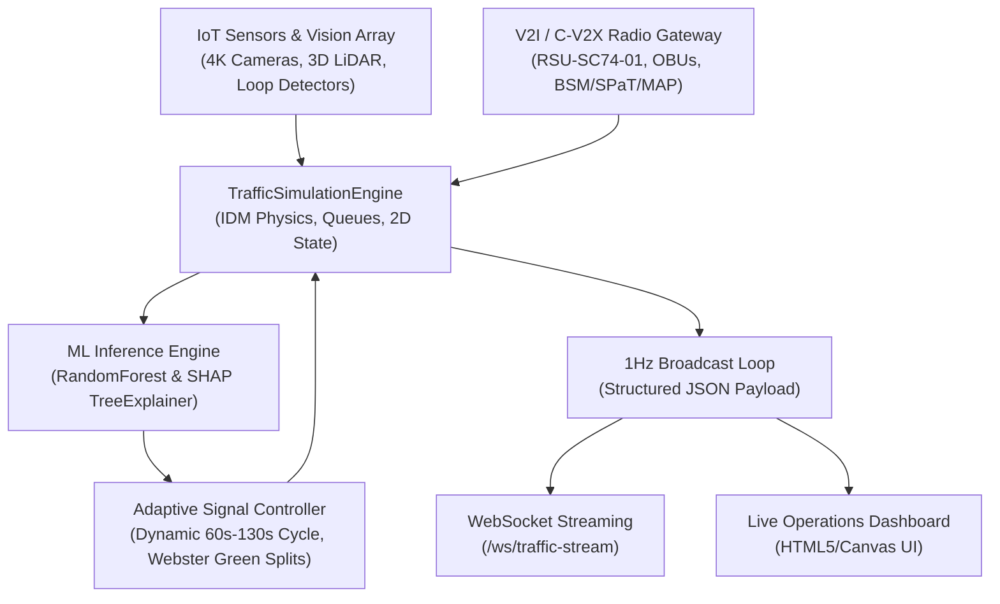

# 🚦 TrafficIQ
### Smart City Adaptive Traffic Signal Control & V2I Telemetry System

<p align="center">
  <strong>Predictive Intelligence. Adaptive Traffic Control. Connected Mobility.</strong>
</p>

<p align="center">
  
  
  
  
  
  
</p>

---

## 📌 Overview

**TrafficIQ** is an intelligent traffic management platform that combines Machine Learning, Explainable AI, Adaptive Traffic Signal Optimization, vehicle simulation, and Vehicle-to-Infrastructure (V2I) communication.

The system aims to address urban traffic congestion by analyzing traffic conditions, predicting congestion levels, and dynamically optimizing traffic signal timings based on real-time vehicle demand.

Designed around a simulated four-way smart city intersection, TrafficIQ integrates predictive analytics with adaptive signal control and real-time telemetry to demonstrate how intelligent transportation infrastructure can improve urban mobility.

### 🎯 Project Objective

To develop a simulation-backed smart traffic management system capable of predicting congestion, optimizing traffic signal cycles, monitoring vehicle movements, and providing real-time intersection intelligence.

### 📍 Target Intersection

| Parameter | Details |
|---|---|
| Intersection ID | `SC-INT-74` |
| Location | Oak Street & 5th Avenue |
| Configuration | Four-way intersection |
| Signal Phases | 4 |
| Adaptive Cycle Range | 60–130 seconds |
| Telemetry Frequency | 1 Hz |

---
---

## 🏗️ Architecture Overview



---

## 🚀 Key Modules

| Module | Description |
|---|---|
| [`main.py`](./main.py) | Core FastAPI application responsible for CORS configuration, REST API endpoints, WebSocket connection management, lifecycle events, 1Hz telemetry broadcasting, and the embedded Smart City Operations Dashboard. |
| [`ml_engine.py`](./ml_engine.py) | Machine Learning inference engine that loads `congestion_model.joblib`, performs real-time congestion classification, and integrates SHAP TreeExplainer for explainable predictions with directional feature attributions (`INCREASES_CONGESTION` / `DECREASES_CONGESTION`). |
| [`traffic_simulator.py`](./traffic_simulator.py) | Four-way intersection simulation for `SC-INT-74`, featuring Intelligent Driver Model (IDM)-based vehicle dynamics, lane-wise queue tracking, vehicle movement, V2I telemetry generation, and Webster-based adaptive signal cycle optimization (60–130 seconds). |
| [`models.py`](./models.py) | Pydantic v2 data models and validation schemas defining API request/response contracts, real-time telemetry structures, sensor health metrics, and SAE J2735-inspired V2I message representations. |
| [`train_model.py`](./train_model.py) | Machine Learning training pipeline responsible for generating the training dataset, preprocessing traffic features, training the congestion classification model, and exporting the trained model as `congestion_model.joblib`. |
| [`test_app.py`](./test_app.py) | Automated test suite covering REST API endpoints, WebSocket communication, ML inference, and adaptive signal override functionality. |

---

## 🚦 Features & Requirements Implemented

### 1. ML Inference Endpoint (`POST /api/predict`)
- **Inputs**: `vehicle_flow_rate`, `average_speed_kmh`, `occupancy_rate`, `queue_length_meters`, `weather_factor`, `peak_hour`, `incident_flag`.
- **Output**:
  - `predicted_congestion_level`: `FREE`, `LIGHT`, `MODERATE`, `HEAVY`
  - `confidence_scores`: Distribution across all 4 classes
  - `shap_feature_drivers`: Ranked list of top feature attributions with impact tags and values
  - `inference_latency_ms`: Sub-millisecond to low-millisecond execution

### 2. Adaptive Signal Optimization Logic
- **Dynamic Cycle Time**: Dynamically adjusted between **60s and 130s** based on predicted congestion level and queue backlogs.
- **4-Phase Sequence**:
  - **Phase 1**: Oak Street (NB/SB) Through & Right
  - **Phase 2**: Oak Street (NB/SB) Protected Left Turns
  - **Phase 3**: 5th Avenue (EB/WB) Through & Right
  - **Phase 4**: 5th Avenue (EB/WB) Protected Left Turns
- **Green Split Allocations**: Proportional distribution based on real-time lane queue demand, clearance intervals (yellow 3s, all-red 1s), and delay reduction metrics.

### 3. Real-Time WebSocket Telemetry Stream (1Hz updates)
Broadcasts structured JSON payload every second over `/ws/traffic-stream`:
- **V2I Hardware Metrics**: RSU status (`ONLINE`), OBU count, BSM (10Hz), MAP (1Hz), SPaT (10Hz), latency (`ms`), and channel occupancy (`%`).
- **Intersection Flow**: Approach-level vehicle rates (`veh/min`), queue lengths (`meters`), average speed, delay reduction savings, and congestion metric distance.
- **2D Simulation State**: Vehicle IDs, types (sedan, suv, truck, bus, ev), coordinates `(x, y)` in meters, speeds, lane IDs, OBU connectivity, and 8 signal light states (`RED`, `YELLOW`, `GREEN`).
- **IoT Sensor Health**: Operational health and coverage for 4x 4K Traffic Cameras, 3D LiDAR, 8x Inductive Loop Detectors, and RSU gateway.
- **City Command Metrics**: City General Index (`0–100`), hourly traffic volume, directional travel times, Intersection Performance Index (IPI), and anomaly alerts (`HEAVY_CONGESTION`, `SHOCKWAVE_DETECTED`, `EMERGENCY_PREEMPTION`).

---

## 🛠️ How to Run

### 1. Start the Server
```powershell
python main.py
```
*Or using uvicorn directly:*
```powershell
uvicorn main:app --host 0.0.0.0 --port 8000 --reload
```

### 2. Access the Live Dashboard
Open your browser to:
- **Operations Dashboard**: [http://localhost:8000/](http://localhost:8000/) or [http://localhost:8000/dashboard](http://localhost:8000/dashboard)
- **Interactive OpenAPI Docs**: [http://localhost:8000/docs](http://localhost:8000/docs)

### 3. Run Automated Tests
```powershell
python test_app.py
```
All 8 test assertions will execute and pass.

