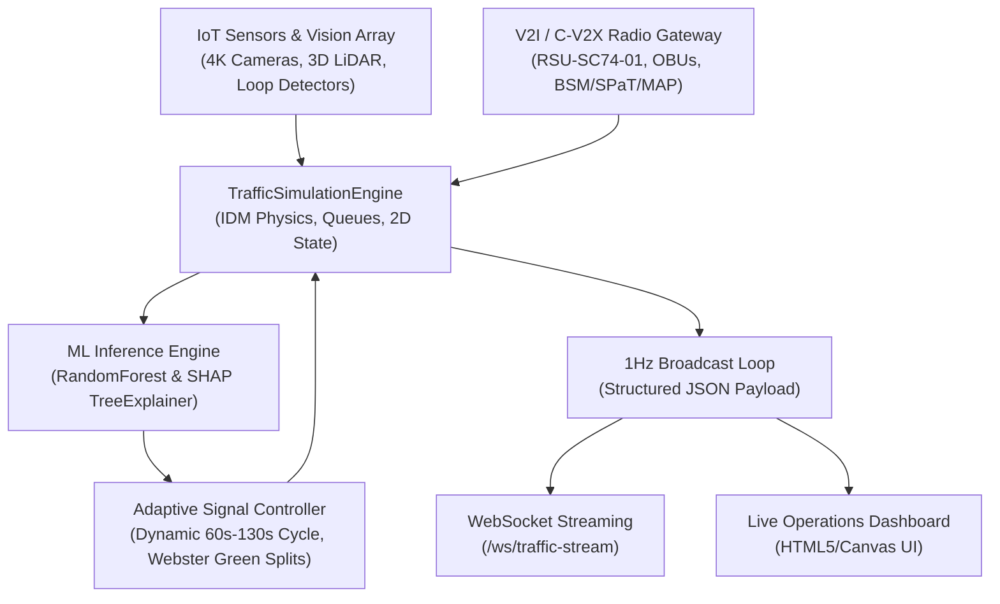

# Smart City Adaptive Traffic Signal Control & V2I Telemetry Server

An enterprise-grade FastAPI backend architected for **Adaptive Traffic Signal Control and Vehicle-to-Infrastructure (V2I)** at **Intersection `SC-INT-74` ("Oak Street & 5th Avenue")**. 

The system serves live machine learning predictions from `congestion_model.joblib`, computes real-time **SHAP feature driver attributions**, dynamically coordinates signal timing cycles using Webster's adaptive density method, and streams 1Hz telemetry over WebSocket (`/ws/traffic-stream`). It also includes a visual HTML5/Canvas Smart City Operations Dashboard at `/`.

---

## 🏗️ Architecture Overview



---

## 🚀 Key Modules

| Module | Description |
|---|---|
| [`main.py`](file:///c:/Users/LENOVO/OneDrive/Desktop/epic project/main.py) | FastAPI application, CORS middleware, WebSocket ConnectionManager, lifespan 1Hz broadcaster, REST routes, and embedded live Operations Dashboard. |
| [`ml_engine.py`](file:///c:/Users/LENOVO/OneDrive/Desktop/epic project/ml_engine.py) | Model loader for `congestion_model.joblib` with integrated **SHAP TreeExplainer** calculating directional feature attributions (`INCREASES_CONGESTION` / `DECREASES_CONGESTION`). |
| [`traffic_simulator.py`](file:///c:/Users/LENOVO/OneDrive/Desktop/epic project/traffic_simulator.py) | High-fidelity 4-way intersection simulation (`SC-INT-74`), 2D vehicle physics (Intelligent Driver Model), queue tracking, V2I telematics, and Webster adaptive cycle timing (60–130s). |
| [`models.py`](file:///c:/Users/LENOVO/OneDrive/Desktop/epic project/models.py) | Pydantic v2 schemas for all telemetry streams, SAE J2735 packet models, sensor health arrays, and API contracts. |
| [`train_model.py`](file:///c:/Users/LENOVO/OneDrive/Desktop/epic project/train_model.py) | Dataset generator and training pipeline for `congestion_model.joblib` (achieves 90% classification accuracy). |
| [`test_app.py`](file:///c:/Users/LENOVO/OneDrive/Desktop/epic project/test_app.py) | Comprehensive test suite validating REST endpoints, WebSocket connections, ML inference, and signal overrides. |

---

## 🚦 Features & Requirements Implemented

### 1. ML Inference Endpoint (`POST /api/predict`)
- **Inputs**: `vehicle_flow_rate`, `average_speed_kmh`, `occupancy_rate`, `queue_length_meters`, `weather_factor`, `peak_hour`, `incident_flag`.
- **Output**:
  - `predicted_congestion_level`: `FREE`, `LIGHT`, `MODERATE`, `HEAVY`
  - `confidence_scores`: Distribution across all 4 classes
  - `shap_feature_drivers`: Ranked list of top feature attributions with impact tags and values
  - `inference_latency_ms`: Sub-millisecond to low-millisecond execution

### 2. Adaptive Signal Optimization Logic
- **Dynamic Cycle Time**: Dynamically adjusted between **60s and 130s** based on predicted congestion level and queue backlogs.
- **4-Phase Sequence**:
  - **Phase 1**: Oak Street (NB/SB) Through & Right
  - **Phase 2**: Oak Street (NB/SB) Protected Left Turns
  - **Phase 3**: 5th Avenue (EB/WB) Through & Right
  - **Phase 4**: 5th Avenue (EB/WB) Protected Left Turns
- **Green Split Allocations**: Proportional distribution based on real-time lane queue demand, clearance intervals (yellow 3s, all-red 1s), and delay reduction metrics.

### 3. Real-Time WebSocket Telemetry Stream (1Hz updates)
Broadcasts structured JSON payload every second over `/ws/traffic-stream`:
- **V2I Hardware Metrics**: RSU status (`ONLINE`), OBU count, BSM (10Hz), MAP (1Hz), SPaT (10Hz), latency (`ms`), and channel occupancy (`%`).
- **Intersection Flow**: Approach-level vehicle rates (`veh/min`), queue lengths (`meters`), average speed, delay reduction savings, and congestion metric distance.
- **2D Simulation State**: Vehicle IDs, types (sedan, suv, truck, bus, ev), coordinates `(x, y)` in meters, speeds, lane IDs, OBU connectivity, and 8 signal light states (`RED`, `YELLOW`, `GREEN`).
- **IoT Sensor Health**: Operational health and coverage for 4x 4K Traffic Cameras, 3D LiDAR, 8x Inductive Loop Detectors, and RSU gateway.
- **City Command Metrics**: City General Index (`0–100`), hourly traffic volume, directional travel times, Intersection Performance Index (IPI), and anomaly alerts (`HEAVY_CONGESTION`, `SHOCKWAVE_DETECTED`, `EMERGENCY_PREEMPTION`).

---

## 🛠️ How to Run

### 1. Start the Server
```powershell
python main.py
```
*Or using uvicorn directly:*
```powershell
uvicorn main:app --host 0.0.0.0 --port 8000 --reload
```

### 2. Access the Live Dashboard
Open your browser to:
- **Operations Dashboard**: [http://localhost:8000/](http://localhost:8000/) or [http://localhost:8000/dashboard](http://localhost:8000/dashboard)
- **Interactive OpenAPI Docs**: [http://localhost:8000/docs](http://localhost:8000/docs)

### 3. Run Automated Tests
```powershell
python test_app.py
```
All 8 test assertions will execute and pass.

